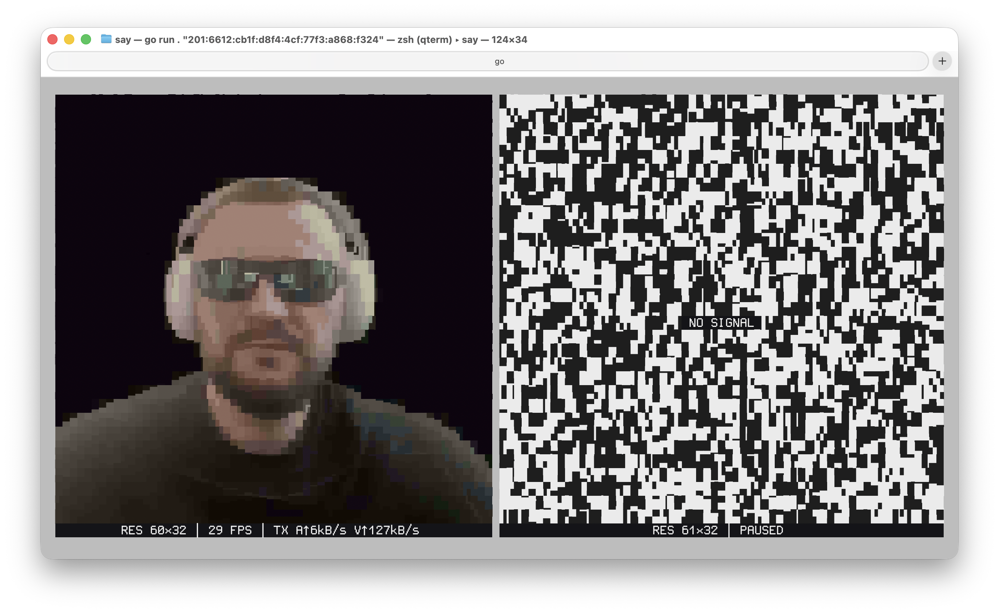
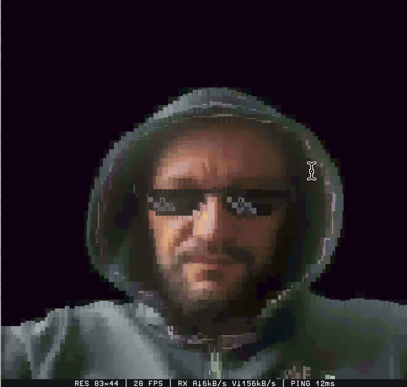
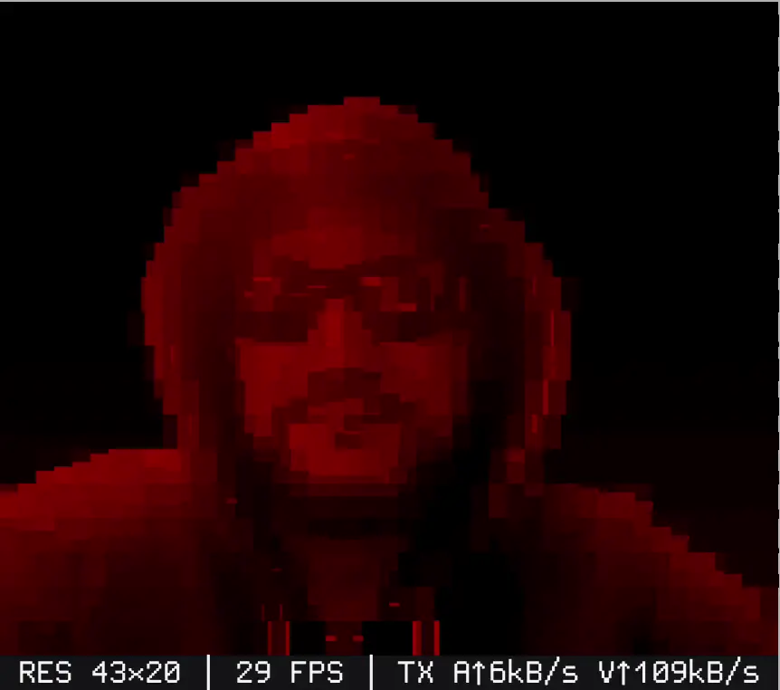
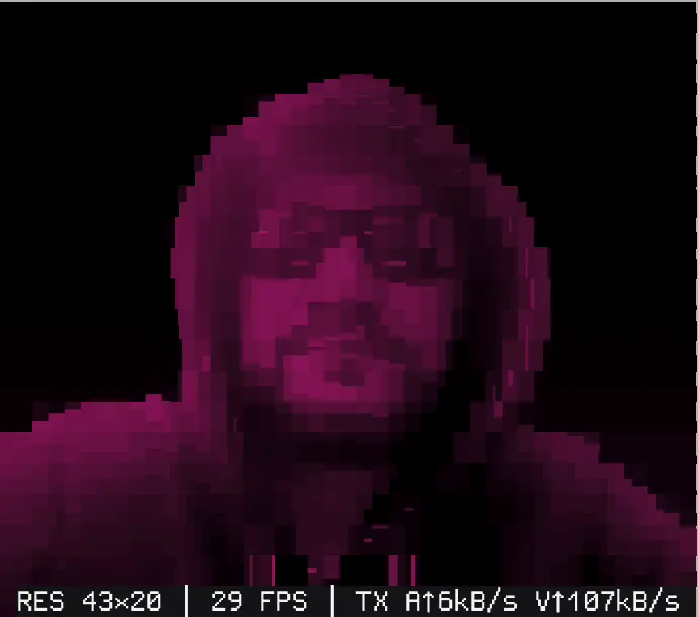
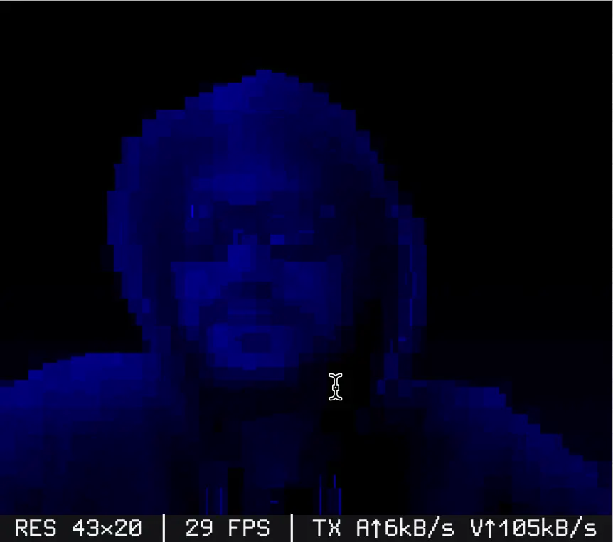

# Say

Say is a terminal‑first voice and video call utility that builds an embedded
Yggdrasil node via [ygg](https://github.com/svanichkin/ygg) and speaks directly
to other peers over the Ygg overlay network.
Audio goes through the system's voice processing on macOS and Windows (echo
cancellation, noise suppression) or is captured and played with
[malgo](https://github.com/gen2brain/malgo) (miniaudio) with Say's own echo
canceller, encoded as pure-Go AMR-NB, Opus or G.722, and sent via UDP for low
latency. Video frames are sourced through
[gocam](https://github.com/svanichkin/gocam), compressed, then rendered in the
current terminal session using Unicode glyphs.





The project is intended as a lightweight experiment: share your Yggdrasil
address, run `say` on both ends, and you have voice/video without deploying an
external Yggdrasil daemon or web stack.

## Filters







## Features

- Embedded Yggdrasil node – no separate daemon required. All call traffic is
  end-to-end encrypted by Yggdrasil, and peer addresses are derived from their
  public keys.
- **Lower voice traffic.** Pure-Go AMR-NB (default, 4.75 kbit/s) uses about
  **90 % less** bandwidth than the 48 kbit/s G.722 of v0.1.3; Opus (12 kbit/s)
  about **75 % less**. Choose the codec with `-audio-codec` (see below).
- **Each side picks its own voice codec.** The handshake tells the peer which
  codec we send, and each side decodes the other's voice with the peer's
  codec, so the two sides may use different `-audio-codec` settings. When
  they differ, the chat says so at the start of the call ("Voice: you send
  AMR-NB, the peer sends Opus.").
- **System voice processing** (`-sysaudio`, on by default on macOS and
  Windows): the system cancels echo, suppresses noise and controls gain.
- **The system knows it is a call.** On Windows Say plays and records on
  the default devices for calls (Settings, Sound) as a communications
  stream, so Windows lowers other sounds while it plays; on macOS the voice
  unit lowers other apps' sound by voice activity, as FaceTime does
  (macOS 14 and later); on Linux the streams have PulseAudio's and
  PipeWire's phone role (`media.role=phone`).
- **Sound keeps playing while Say is busy.** The system's audio thread only
  moves samples through lock-free rings; Say's goroutines fill and empty
  them on threads raised to the priority the system gives audio.
- **Protocol versions.** The handshake carries the protocol version and the
  Say version of each side. A peer that cannot talk to ours is refused with a
  message naming both versions ("PROTOCOL MISMATCH … Patch both sides to
  the same version"). A peer from before versioned handshakes (v1.0.0)
  is still accepted; the chat then notes that voice works only with the same
  `-audio-codec` on both sides.
- Acoustic echo cancellation with a reference delay estimated from the requested
  speaker buffer. The filter resets on reference discontinuities; actual device
  latency (especially Bluetooth) can differ from this estimate.
- Video in a two-pane terminal layout (square panes), synchronised with the
  audio of the same peer.
- **Video that does not stop on loss.** Each frame goes whole in one
  datagram by default; `-video-band N` cuts the picture into bands of N
  rows, each a stream of its own in its own datagram, so that a lost
  datagram breaks its band only, which shows the no-signal noise until it
  recovers. Either way a frame recovers from the newest one the receiver
  decoded (no keyframe), and after a loss every frame is coded against one
  the receiver acknowledged, so a lost datagram is lost alone. Bands cost
  more: over Yggdrasil every datagram carries some 300 bytes of headers, and
  bands of a row sent 360 datagrams a second instead of 30, with the path's
  delay swinging and the sound waiting longer.
- **Rate control as WebRTC's.** The receiver reports every 100 ms what
  arrived, its loss and the standing queue on the way; the sender cuts its
  rate to below what arrived when a queue stands and less arrives than went,
  gently on heavy loss, and raises it on a clean path. Bands go while the
  rate's budget holds, the longest waiting first (short of rate the picture
  changes a part at a time), and the grid fills the rate, down to a quarter
  of the requested rows, changed only for a clear difference. A still
  picture keeps the rate near what it uses, so that a picture that moves
  again does not pour into a link that narrowed meanwhile. Tried on a
  simulated path (loss in bursts, a link narrowing to 100 kbit/s, path
  switches with the round trip up to 6 s): the picture stops mostly while
  the path carries nothing.
- **Change-only video frames.** After a full frame, only the cells that
  changed are sent; together with `-video-hold` a still picture costs a few
  hundred bytes per frame instead of several kilobytes. Both peers need this
  version (protocol 14).
- **Small fixed buffers.** Every call plays with a 10 ms x 2 speaker buffer
  (like the macOS system voice unit's ~10.7 ms IO buffer) and a 40 ms jitter
  buffer, in the LAN and over the internet alike. Steady clock drift between
  the two peers' sound cards is corrected by at most one sample per 20 ms
  frame.
- Capture sample indices survive dropped microphone blocks. A separate bounded
  send queue prevents a stalled transport from blocking capture/AEC; old encoded
  speech is discarded with its original timestamp preserved.
- **Local network calls.** Peers in the same LAN (or on the same machine) find
  each other by Yggdrasil multicast and connect directly instead of through
  internet peers. `-nolan` turns this off.
- **Light on CPU.** The video encoder reuses the result of every cell whose
  pixels did not change since the last frame (about three in four on a
  camera), matches glyphs per colour instead of per pixel and needs no
  per-frame allocations; your own picture is shown without compressing it.
  Encoding a frame is 3.5–4.5 times faster than in v1.0.0, with the same
  output. On a MacBook Air a call takes about 56 % of one core instead of
  about 76 % with v1.0.0 and v0.1.3; Say's own code is about 4 % of it, the
  rest is macOS camera effects, voice processing and capture.
- **Chat and file transfer** during a call (see below).
- One call at a time: other callers get a "busy" answer; a peer that
  reconnects after a drop replaces its stale call.
- **Home screen and contacts**: waiting for a call, Say shows its contacts,
  a folder of vCard files (see below), and calls them from there.

## Audio diagnostics

To compare raw microphone, echo reference and processed microphone, opt in to
local recording before launching Say:

```sh
SAY_AUDIO_TRACE=/tmp/say-audio ./bin/say
```

Each call writes a separate private three-channel WAV file (8 kHz, 16-bit PCM):
channel 1 is the microphone, channel 2 is the exact reference passed to the echo
filter, channel 3 is its output. Disk writes run separately from capture; the
log reports any diagnostic frames dropped if the disk cannot keep up. Recording
is off unless this environment variable is set. These files contain the call's
audio. Compare channels to locate whether distortion starts before or after
AEC; a real device recording is needed to verify its estimated delay.

## Chat and file transfer

The lower part of the call screen is a chat. Type a message and press Enter;
your messages appear on the left, the peer's on the right. Long messages wrap,
and wide characters (CJK, emoji) are measured correctly.

To send a file, type, paste or drag its path (or drop the file into the terminal,
which pastes a `file://` URI) and press Enter. On both sides the
file's chat entry shows its progress, updated in place: how much of how
much (B, kB, MB or GB), the percentage and the current speed (Bps, kBps,
MBps). When the transfer ends the entry shows the result with the size, the
average speed and the time. The input line stays free: you can keep
chatting; a second file waits until the first one is sent. The receiver saves the file to `~/Downloads` and confirms it; the
sender's chat shows **Sent** only after that confirmation, or the receiver's
error (for example, a full disk). File transfer runs as fast as the path allows
(there is no fixed limit) while keeping the extra delay it adds small, so
that voice and video stay smooth.

## Requirements

- Go **1.27.3** (minimum) with cgo enabled for native audio I/O. All three audio codecs are pure Go.
- A working microphone for voice calls and, if you enable video, a webcam that
  is supported by your OS (V4L2 on Linux, AVFoundation on macOS, Media
  Foundation on Windows).
- Linux cameras: every `/dev/video*` capture node is tried in turn (video
  codecs and other nodes are skipped); `-camera /dev/video2` picks one.
  `v4l2loopback` devices are used in the format their producer chose.
  SoC cameras with a media controller (PinePhone and similar boards) are
  linked and configured automatically, preferring the front camera;
  `GOCAM_SENSOR=ov5640` picks a sensor by name. The user needs access to
  `/dev/video*` (the `video` group), and for SoC cameras to `/dev/media*` and
  `/dev/v4l-subdev*`. Sensors that only output raw Bayer (they need an ISP)
  are not supported.
- System libraries required by miniaudio / Gocam (on Linux ensure ALSA/ Pulse
  dev packages are available; on macOS you just need Xcode command line tools).
- Permission to access camera and microphone for the terminal session.

## Install manual

Go to [Releases](https://github.com/svanichkin/say/releases) download adn start it

## Install with install script from a GitHub release

```sh
curl -fsSL https://raw.githubusercontent.com/svanichkin/say/main/scripts/install-release.sh | bash
```

OR

```sh
wget -qO- https://raw.githubusercontent.com/svanichkin/say/main/scripts/install-release.sh | bash
```

The script detects your platform, downloads the latest release artifact from
GitHub, and installs `say` into a sensible default directory:

- macOS: `/usr/local/bin` (asks for `sudo` if needed). It comes before `/usr/bin`
  in the default `PATH`, so `say` runs Say instead of the system text-to-speech
  `/usr/bin/say` (still available by its full path).
- Linux/BSD: `$HOME/.local/bin` for non‑root users, `/usr/local/bin` otherwise.
- Windows (MSYS/mingw/git-bash environments): `%USERPROFILE%\AppData\Local\Programs\say`.

Override the target via `INSTALL_DIR=/custom/path ./scripts/install-release.sh`.
Supply a specific tag with `VERSION=v0.4.0 ./scripts/install-release.sh`, or
point to a fork using `REPO=myuser/say ./scripts/install-release.sh`. Ensure
`curl`, `tar`, and (for Windows archives) `unzip` are available, and add the
chosen install directory to your `PATH` if needed.

## Installation with Go install

Very simple for linux/macos

```sh
CGO_ENABLED=1 go install github.com/svanichkin/say@latest
```

Then use

```sh
~/go/bin/say
```

Windows with CMD

```sh
set CGO_ENABLED=1
go install github.com/svanichkin/say@latest
```

Windows with Powershell

```sh
$env:CGO_ENABLED = "1"
go install github.com/svanichkin/say@latest
```

Then use 

```sh
C:\Users\USERNAME\go\bin\say.exe
```

## Installation with AUR

The package is also available on the AUR, if you use an AUR helper, you can install it for example with:

```sh
yay -S say
```

## Installation with Git

```sh
git clone https://github.com/svanichkin/say.git
cd say
make
```

You can also run the tool without building a binary linux/macos:

```sh
env CGO_ENABLED=1 
go run .
```

Windows with CMD

```sh
set CGO_ENABLED=1
go run .
```

Windows with Powershell

```sh
$env:CGO_ENABLED = "1"
go run .
```

### The video coder (Babe)

The smooth video coder is Babe's (`github.com/svanichkin/Babe`), a private
module: building Say fetches it with `GOPRIVATE=github.com/svanichkin/Babe`
and a git login that can read it (the release workflow: the `BABE_TOKEN`
secret, a token with read access to that repository). Working on both, a
`go.work` beside `go.mod` (ignored by git) builds Say against a Babe
checkout instead: `go work init . ../path/to/Babe`.

### Debug build

Builds are release builds by default. A debug build (`-tags debug`) traces
calls in detail: `[debug]` and `[trace]` lines with `-log debug`, the peer's
log sent over the call to a caller started with `-log debug` (saved beside
ours as `*-peer.log`), and on Windows a debug log without any flags. It is
for chasing problems in calls, not for everyday use: the tracing takes some
CPU, the log grows by tens of MB an hour, and the log sent over a call takes
bandwidth from it and shows the peer your addresses.

```sh
make debug                                   # this machine, into bin/
make build-windows/amd64 GOTAGS=debug        # any target of make build-all
go build -tags debug .                       # without make
```

### macOS app

`make app` puts `Say.app` into `bin/` (`make app GOTAGS=debug` for a debug
build). Started from it (a double click, Launchpad) Say opens its window; the
bare `say` is the terminal utility and works in a terminal, however started.

`make notarize` signs it with the Developer ID and the hardened runtime
(camera, microphone, contacts: `scripts/say.entitlements`), has Apple notarize
it, staples the ticket and packs `bin/Say-macos.zip`, which opens on any Mac
without the "unidentified developer" warning. Once, the notary's API key into
the keychain: `xcrun notarytool store-credentials say-notary --key
AuthKey_<ID>.p8 --key-id <ID> --issuer <issuer ID>`. A tag `v*.*.*` does the
same on GitHub (`.github/workflows/go.yml`, secrets `DEVELOPER_ID_P12`,
`DEVELOPER_ID_P12_PASSWORD`, `NOTARY_KEY`, `NOTARY_KEY_ID`, `NOTARY_ISSUER_ID`)
and releases `say-macos-universal.zip`.

### Plan 9 window

Started in a rio window of its own (not in `vt`; drawterm too), Say draws
the same window as on macOS and Windows through `/dev/draw`: the video panes
as pictures in their neon frames, the border, the captions, the chat. It is
drawn by the CPU (no Ebitengine there), at Unifont's 8x16 cells, and only
what changed is sent. Keys come from `/dev/cons` (Del or Ctrl-C stop Say),
clicks from `/dev/mouse`; the window can be resized. In `vt` Say stays the
terminal utility, in 16 colours.

### Linux and BSD desktop

`make install-desktop` puts Say into the desktop's menu for this user (a
launcher and the icon, `say` must be on the `PATH`); the launcher opens Say in
a terminal. Started without a terminal in a graphical session (a double click
in a file manager) Say reopens itself in one: `$TERMINAL`, then
`x-terminal-emulator`, then the common terminals (GNOME's, Konsole, Xfce's,
kitty, Ghostty, Alacritty, WezTerm, foot, xterm). A package puts the same files
into `/usr/share/applications` and `/usr/share/icons/hicolor`.
The bundle has the camera and microphone usage strings macOS asks for. It is
signed ad hoc, so macOS may ask for the camera and the microphone again after
each new build.

## Configuration

Say stores its configuration under your OS config directory: on Linux this is
typically `$XDG_CONFIG_HOME/say/config.json` (or `~/.config/say/config.json` if
`XDG_CONFIG_HOME` is unset), while on macOS it resolves to
`~/Library/Application Support/say/config.json`. You can point to a different
path with `-config /path/to/config.json`.

The configuration file is a regular Yggdrasil node config. Pass the same
config file to Say – the embedded node uses it to bootstrap.

## Home screen and contacts

Waiting for a call, Say shows its home screen: a menu in columns, as SSHS
draws its list. The column being chosen in stands in the middle, its chosen
line always on the middle row: the arrows move the list under it. → or Enter
opens the chosen item (its column comes to the middle, the one before stands
to its left, only its chosen line bright), ← or Esc goes back, `<` goes back
one column and `x` to the first one (in the first one, `x` quits Say). The
chosen line is in the colour of its address, the one its frame has in a call.
A click on a line does what Enter does; letters typed jump to a name; an
address pasted is called at once.

- The contacts are where you chose in the settings, else by default: on
  macOS the **OS address book** (Contacts; the system asks for access the
  first time the contacts are opened; refused, the folder below), elsewhere
  the folder where the system keeps contacts or they usually are, made when
  a card is first written: Windows `%USERPROFILE%\Contacts` (the Contacts
  folder every user has), Linux and the BSDs `~/.local/share/contacts`
  (`$XDG_DATA_HOME/contacts`; vdirsyncer and khard keep a folder of cards
  there), Plan 9 `$home/lib/contacts`, macOS without access
  `~/Library/Application Support/say/contacts`. The default is not written
  to the settings: only a choice is. In the settings: the **OS address
  book** (macOS only; entering it chooses it and opens **my card**) or a
  **contacts folder**, the one in use ticked.
- **Contacts folder** → **choose a folder** (folder by folder from the top,
  `<` going back up; entering a folder chooses it, ticked) while there is none;
  once there is, its path (entering it opens the folders from the top down
  to the ones it is among, it ticked in the middle, so `<` goes up a level at
  a time) and **my card**.
- **Your card** is, in a folder, the one whose file is marked `me`: an
  extended attribute any program can read and set (`user.me` on Linux, an
  alternate data stream `file.vcf:me` on Windows), its value the card's UID
  (a file may hold several cards); renaming the file keeps it, and Say keeps
  it when it rewrites the file. In the address book it is the card Contacts
  has as yours, unless you choose another in Say. **My card** lists the
  cards, yours ticked: choosing another moves the mark (or the choice) to
  it; in a folder `+` makes a card (first name, last name, middle name,
  nickname). This Say's address is put on your card, labelled with the
  device's kind, and taken off any other. A folder with no file marked `me`
  (another program rewrote yours and lost the mark) gets it back on the one
  card with this Say's address.
- With a card of yours chosen, **this device's label** stands under it:
  one field with the label this device has on your card, typed in at once;
  erased, it is the device's kind again (**laptop** when it has a battery of
  its own, else **computer**).
- **Show contacts as** (under the folder and the address book): the
  nickname, first and last name, last and first name, or initials and last
  name (S.S.Vanichkin), each shown as your own name looks in it, the one
  chosen ticked; a card without what the choice takes shows its name.
- Then the first column is **Contacts**, **Call an address** (a field: type
  an address, Enter calls it; not an address, it blinks), **My address**
  (this Say's, `[address]:port` with the port only when it is not 7777:
  Enter or a click copies it), **Settings** and `x`: in the window `x`, as
  the window's own close button, hides the window, Say going on and waiting
  for calls (a call coming in shows it again, so does the Dock); Cmd+Q or
  Ctrl+C quit; in a terminal `x` quits. **Settings → Say's icon**: **In the
  Dock**, or **In the tray** (macOS: the menu bar, no Dock icon; kept in
  `config-tray.json`), whose menu has the contacts, a green or red ● before
  each, each opening to its devices to call, then **Open Say** and **Quit**.
  Windows' notification area is to come. Every item begins with
  a capital, as the call view's menu does. A field chosen shows what it
  holds and a blinking cursor, as the chat's input; its placeholder only
  when it is not chosen. The chosen line's block is its text's colour (red
  on `x`). The contacts
  are your own card (first; "Me" until there is one), the people, and `+` to add one.
  A person opens to **call <label>** for each of their devices (your own
  card: your other devices, not this one). The cards are edited from the
  settings: **Edit contacts**, under **Show contacts as**, lists your card
  and the people, each opening to its form: the names,
  the devices, each opening to its label and address (`[address]:port`, the
  port only when it is not 7777; this device's address is its own, not
  edited; an address erased removes the device, and so does `−` under the line, red: pressed once it reads **Delete forever**, pressed again it deletes; moving off it, or out of the menu, makes it `−` again; `+` is green), and `+`, which adds a
  device and opens it, written once its address is in; under it `−` (pressed
  twice, as a device's) takes the person out of Say: a card Say made is
  deleted, one made elsewhere (the system's book, a folder shared with other
  programs) loses its Say addresses only, all else kept; our own card has
  none. **Edit contacts** has `+` too, as the contacts do. A field is written
  as it is left.
- `+` in the contacts makes a person the same way (names, devices, `+`),
  but nothing is written while its form is open: leaving it makes the card,
  with a name and an address (the first try to leave without them makes
  the empty ones blink).
- **Cards in a call.** Right after the handshake each side sends its own
  card (protocol 15, frame 0x12): the names, the nickname, the devices with
  their labels and addresses, nothing else of the card; the chat is left to
  what people write. The card sent always has the device calling on it.
  With a folder of contacts and no card of its own, Say makes one when it
  starts: the computer's name as its nickname, this device on it, to rename
  as any card (with the system's address book, one of that device alone is
  sent, nothing written there). A
  card from an address already in the book is that person's for sure (a mesh
  address comes from its key): what it adds, a second device, a nickname, is
  written to their card, nothing written over. A card from an address the
  book does not have waits, Say's own (`config-contacts-pending/`), under
  **unconfirmed N** in the contacts: **confirm** (a new contact), **add to
  <name>** (a contact of the same name), or **delete**. Peers of protocol 14
  are still talked to: they ignore the card.
- While a call is dialled, its screen has **x** under a line (on the chosen
  block, as a menu's): Enter, a click on it or Esc cancels the dial and
  Say is back on the home screen.
- **A call rings before it is answered** (protocol 17). The one called sees
  **INCOMING CALL**, who calls and their address, and under a line **✓**
  (answer) and **x** (decline): ↑ and ↓ choose, Enter or a click does it,
  Esc declines. The caller sees **Ringing, waiting for an answer**; declined,
  or unanswered for 30 seconds, or the line busy (the one called in a call,
  or another call ringing there), the caller is back on the home screen at
  once. Hanging up while it rings takes it off the other screen. A Say of
  protocol 14-16 is answered at once, as before, both ways.
- A call made from the home screen tries three times, then the call goes on
  until either side hangs up (the self view's menu has **x**, in red as the active menu's x; in the window a view's menu shows while the pointer is over it, and goes as it leaves) and Say
  is back on the home screen.
- **Who is online.** Every 30 seconds, while no call is on, Say asks each
  device in the contacts (but this one) whether Say runs there: PING in place
  of the handshake (protocol 16), answered PONG, no call begun and the line
  not taken; a device that has not answered in 5 seconds is not there. A
  person with a device that answered has a green ● before their name, and
  so has that device's **call on** line. A device asked that has not
  answered is not called (Enter makes it blink). The dot is red from the
  start and turns green once the device answers, a person's when one of
  theirs does; Say asks at once when it starts and when the contacts are
  read. This device is shown on your card, not
  called. A Say of protocol 14 or 15 answers
  PING as a peer too old: it counts as online all the same, and is still
  called. A mesh peer cannot say it came up, so asking is the only way.

The folder holds vCard files (`.vcf`, versions 2.1, 3.0 and 4.0 read, 3.0
written, as macOS Contacts writes them), so it can be kept in step with a
CardDAV server by vdirsyncer, or synced by iCloud Drive, Dropbox or
Syncthing. A file may hold several cards. A person's devices are their Say
addresses, each a link with a label (Contacts shows a link under its label;
an instant messaging address it shows under the service's name, so Say's
of before, `IMPP;X-SERVICE-TYPE=Say`, are read and rewritten as links):

```
BEGIN:VCARD
VERSION:3.0
FN:Alice Ivanova
N:Ivanova;Alice;;;
item1.URL:say:[200:abcd::1]
item1.X-ABLabel:home
item2.URL:say:[201:1::2]:7001
item2.X-ABLabel:phone
UID:6F1E…
END:VCARD
```

The port is written only when it is not 7777. A card Say changes keeps every
line it does not know (photos, phones, notes). Say reads the cards once and
reads them again only after its own writes and when the system tells of a
change by another program (FSEvents or kqueue on macOS, inotify on Linux,
ReadDirectoryChangesW on Windows, Contacts' own notice for the address book;
on Plan 9, which tells nothing, only after its own writes). Say's own
settings, the source, the folder, how names show, who was called last, and
your card in the address book when you chose another than Contacts' own,
are kept in `config-contacts.json` beside `config.json` (the node rewrites
`config.json` itself). The old contacts
format (a folder per friend with a `say` file) is no longer read.

The utility automatically updates the list of peers each time it starts.

## Usage

Run Say on one machine in listen mode:

```sh
./say
```

The program prints your Yggdrasil address. Share it with a friend and have them
dial you:

```sh
./say "200:abcd:1234:..."
```

Optionally pass the port as a separate argument, in any order:

```sh
./say "[200:abcd:1234:...]:7777"
./say 7777 "200:abcd:1234:..."
./say "200:abcd:1234:..." 7777
```

To bypass Yggdrasil and use ordinary TCP/UDP over a regular IP address, select
the plain transport explicitly:

```sh
./say -transport plain -port 7000
./say -transport plain -port 7001 "127.0.0.1:7000"
```

Select alternative configs explicitly via `-config work` (which maps to
`$XDG_CONFIG_HOME/say/work.json`). Positional arguments are interpreted as
either a dial target (`"200:abcd:..."`) or a name from the contacts
(`"Alice Ivanova"`: the device last called, else the first). To run the server with another profile, always
pass `-config`; bare tokens are no longer treated as profile names.

Audio and video are always enabled when hardware is present; no extra flags are
required. The two peers may use different audio codecs: each announces its own
in the handshake (Say v1.0.0 and older announce none, so with them use the same
codec on both sides). Relevant CLI switches:

- Without `-log`, Say writes logs only to stderr. With `-log`, it also writes a log file next to the running executable using the config name, for example `-config client` -> `client.log`. The resolved path is printed on startup. Use `-log debug` for the most detailed file logging.
- `-port` – listening TCP/UDP port (defaults to `7777`).
- `-transport` – network backend: `ygg` (default, embedded Yggdrasil) or `plain` (ordinary TCP/UDP over regular IP). With `ygg`, nodes in the same local network discover each other by multicast and connect directly, bypassing internet peers.
- `-fps` – optional cap on the video frame rate. Without it every camera frame is coded, and the rate control sends what the path allows.
- `-video-hold=N` – stops a still picture from shimmering: a cell keeps its previous glyph and colours while its new look differs by at most N (mean colour difference per pixel, default `13`, `0` disables; higher is calmer, but low-contrast details start to lag; a cell held 8 frames is kept only while it differs by less than N/2, so slow changes come through in the end). N holds up to 88x36 cells, the camera's own pixels; a larger frame holds harder, up to 2N at 160x65: finer cells mostly carry the camera's noise there (160x65 at 2N takes about 40% fewer bytes than at N and looks the same).
- `-video-hold-debug` – tint the cells kept by `-video-hold` lilac, to see how many there are.
- `-video-codec=say` – (both peers) Say's video of cells as before (as protocol 8 sent it). By default the video goes in pixels by Babe's split coder (as Babe's BabeCam codes video): blocks of an error-split tree that copy the frame before (moved or not) or are drawn anew, a frame the camera hardly changed not sent; the window shows the pixels, the terminal turns them into its cells; the rate is met by the quality (down to q10) and by frames left out. `-video-q=N` – its quality on a path with loss, a queue or a cut of the rate (default 40); `-video-qmax=N` – how high it rises on a path clean for 3 s, a point every 0.5 s (default 50).
- `-video-fx=NAME` – (the window) the effect over both video panes, `hologram` by default (`none`: off): `hologram`, `neon`, `thermal`, `duotone`, `bladerunner`, `poster`, `aberration`, `crt`, `glitch`.
- `-video-light` – (the window) the exposure as a photo editor's shadows and highlights with auto levels, both panes: each place lifted or toned by its own light (a dark face before a bright window lifted, the window not burnt), then the range stretched to full; slowly following the picture (the hologram has it anyway); the stream is not touched.
- `-video-sharp=N` – (the window) the video's sharpness, percent, 100 by default (`0`: off): an unsharp mask over the luma at the picture's own size before it is drawn larger, the coder's faint noise left alone and no rings round edges; the stream is not touched.
- `-video-band=N` – the height of the video's bands in rows (default `0`: one band, the whole picture in one datagram). Each band is its own stream in its own datagrams: a loss breaks only its band, shown as noise until it recovers. Shorter bands send more, smaller datagrams, each with Yggdrasil's headers: more traffic and more delay.
- `-netsim[=NAME]` – for testing (bare: `heavy`, the worst): this side's outgoing sound and video go through a simulated bad path on top of the real one, and the peer shows what arrives. `loss`: 3% loss in bursts; `narrow`: a link of 1000 kbit/s narrowing to 150 for 10 s of every 30; `switch`: a path switch every 40 s (1 s of outage, the round trip up to 6 s and back down to about 200 ms over some 15 s); `mixed`: these in turn over 60 s; `heavy`: all at once (300 kbit/s dropping to 100, 3% loss in bursts, a switch every 30 s). Datagrams wait in the link's queue (dropped past 1 s), take half the round trip plus up to 50 ms more, and are lost by 1400-byte fragment. Set it on both peers for both ways; the control connection is not touched.
- `-camera /dev/videoN` – use this camera device only (Linux). Without it every `/dev/video*` capture node is tried in turn. Use it when a phone or board exposes several nodes, for example a `v4l2loopback` device that another program (such as a PinePhone camera service) fills: `-camera /dev/video0`.
- `-camera clip.y4m` (or `clip.frames`) – a video file as the camera, in a loop at its own rate: where there is no camera (a virtual machine, Plan 9 without a USB one) or for a repeatable picture. `.y4m` is uncompressed YUV4MPEG2, what video test sets come in and ffmpeg writes (`ffmpeg -i clip.mp4 -vf scale=352:288 -pix_fmt yuv420p clip.y4m`); `.frames` is what `go run ./cmd/recordframes` records from a camera.
- `-colors 16|truecolor` – colour output. `16` uses only the 16 ANSI colours (8 for backgrounds), with dithering, for terminals without 24-bit colour such as Plan 9's `vt`; it is the default on Plan 9, `truecolor` elsewhere.
- `-nomic` – listen only: the microphone is not opened and no audio is sent (handy for testing two instances on one machine without an echo loop).
- `-lang <code>` – the language Say speaks to you (`-lang ru`, `-lang ja`, …). Without it Say takes the first of the system's preferred languages that it knows, else English. It knows en, ru, uk, be, kk, uz, az, ka, hy, de, fr, es, pt, it, nl, pl, cs, sk, sl, hr, sr, bg, ro, hu, fi, sv, nb, da, et, lv, lt, el, tr, id, ms, vi, zh, zh-Hant, ja and ko.
- `-gui` – a window instead of the terminal (macOS, Windows, Plan 9); `-text` – the terminal. With neither: on macOS `Say.app` opens its window and the bare `say` is the terminal utility, however it is started; on Windows a double click in Explorer (or a shortcut) opens the window and `say` typed in cmd, PowerShell or Windows Terminal works in it, its output redirected or not; on Plan 9 `say` in a rio window of its own (or drawterm's) draws the window, and in `vt` it is the terminal utility. Over SSH always the terminal. The window opens where it was closed, as large (kept beside the configuration, `config-window.json` for `config.json`). The window draws the same interface with the system's monospace font: video panes and the chat in neon HUD frames (their shapes follow each person's address), glints running along them, a hazard-striped border. Cmd+ and Cmd- (Ctrl on Windows) change video detail by one row and proportionally one or two columns per press. Detail can reach twice the pane size, within the codec's 160x80-cell limit.
- `-nolan` – turn off Yggdrasil LAN discovery (multicast peering in the local network).
- `-nodirect` – no direct calls. By default a call goes directly between the two machines, without public Yggdrasil peers in between: they connect through their NATs (UDP hole punching, as WebRTC does) for lower latency and fewer delay spikes and drop-outs, and fall back to the Yggdrasil route when the direct link does not get through or turns out worse. Each side then sees the other's public IP address, which Yggdrasil otherwise hides, and Say asks public STUN servers (Google, Cloudflare, Sipnet) for its own. With `-nodirect` on either side the call stays on its Yggdrasil route and the IP addresses stay hidden.
- `-nowt` – Windows: stay in the classic console. Started by a double click in a console of its own, Say reopens itself in Windows Terminal when it is installed: the classic console has no font fallback, so it shows the picture's block and line characters as boxes.
- `-sysaudio on|off` – the system's voice processing instead of Say's own echo canceller. On by default on macOS and Windows; `-sysaudio off` (or `-sysaudio=false`) uses Say's own audio: miniaudio for the devices and Say's echo canceller.
  - What it does: the system cancels echo, suppresses noise and controls the microphone gain.
  - macOS: VoiceProcessingIO (as used by FaceTime) plays and records. The microphone mode chosen in Control Center (Standard, Voice Isolation, Wide Spectrum) applies.
  - Windows: the Voice Capture DSP records the default microphone and takes the default speaker's output as the echo reference; Say plays through the default speaker.
  - The speaker buffer is chosen by the system; the output latency it reports is used to sync video (and logged).
  - Cost: the system's noise suppression is a neural network and takes some CPU (on a Mac roughly 7–17 % of one core during a call). Turn it off if the CPU matters more than echo and noise.
  - Where it is unavailable (other platforms for now) Say falls back to its own audio.
- `-audio-codec amrnb|opus|g722` – the codec your voice is sent with:
  - `amrnb` (default) – AMR-NB at 4.75 kbit/s with silence suppression: the least traffic, phone-like sound.
  - `opus` – Opus at 12 kbit/s: clearer voice for about 2.5 times the traffic.
  - `g722` – G.722 at 48 kbit/s (the codec of v0.1.3): no packet loss concealment beyond fading, ten times the traffic of AMR-NB.
  - All three take well under 1 % of one CPU core. The peer decodes whatever you send, so each side may choose its own codec; only with Say v1.0.0 and older (no codec in the handshake) both sides must use the same one.
- `-config` – config profile or path; `-config work` maps to `$XDG_CONFIG_HOME/say/work.json`.
- `-log` – write `<config-name>.log` next to the running executable. `-log debug` also enables verbose debug logging.
- `-contacts` – the contacts folder (kept for next time, as the home screen's settings set it).
- `-v` – verbose logging.
- `-version` – print version and exit.
- `-donate` – print donation information and exit.
- `-support` – print support link and exit.
- Color filters: `-red`, `-orange`, `-yellow`, `-green`, `-teal`, `-blue`, `-purple`, `-pink`, `-gray`, `-bw` – apply a tinted (or neutral) monochrome filter to the local/remote viewports (purely visual, codec stream stays untouched). Use at most one flag; if several are present the last one wins. In the window (`-gui`), `-bw` shows each pane in its owner's colour instead: ours in our accent, the peer's in theirs.
- Video display applies a mild gamma lift (`0.9`) to reveal shadow detail in both the window and terminal. It changes only local rendering, not the codec stream.

When media is disabled on both ends, Say falls back to a simple line‑based text
bridge over the established TCP session.

### Example call flow

1. Both peers ensure their configs contain working Yggdrasil peers.
2. Alice runs `./say`.
3. Bob runs `./say "alice-ygg-addr"`.
4. Speak! Use `Ctrl+C` to terminate; the app restores the terminal state.

## License

This project is distributed under the terms of the [MIT License](LICENSE).

### Donate

Monero 41uoDd1PNKm7j4LaBHHZ77ZPbEwEJzaRHhjEqFtKLZeWjd4sNfs3mtpbw1mcQrnNLBKWSJgui9ELEUz217Ui6kF13SmF4t5
