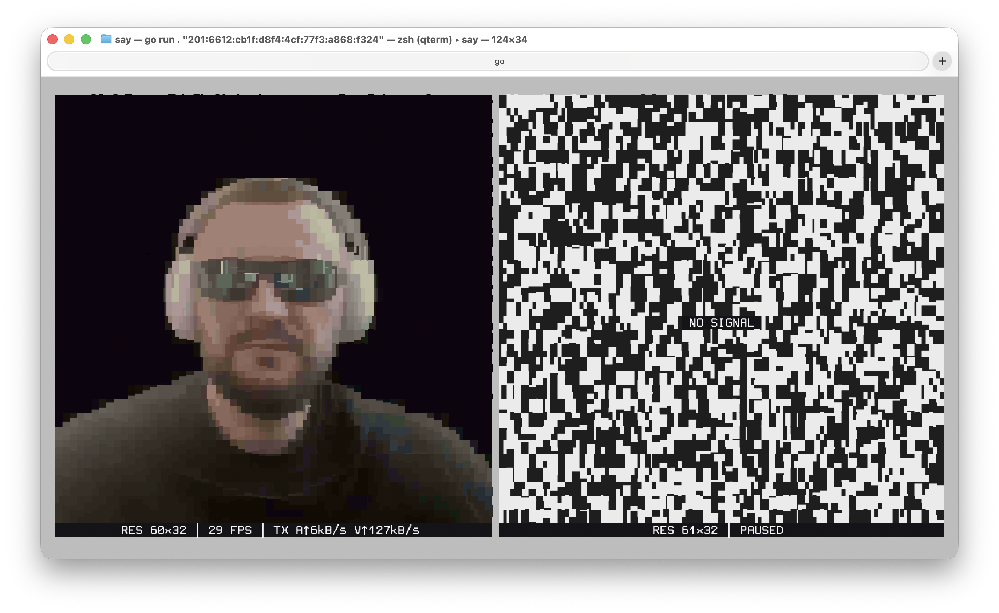
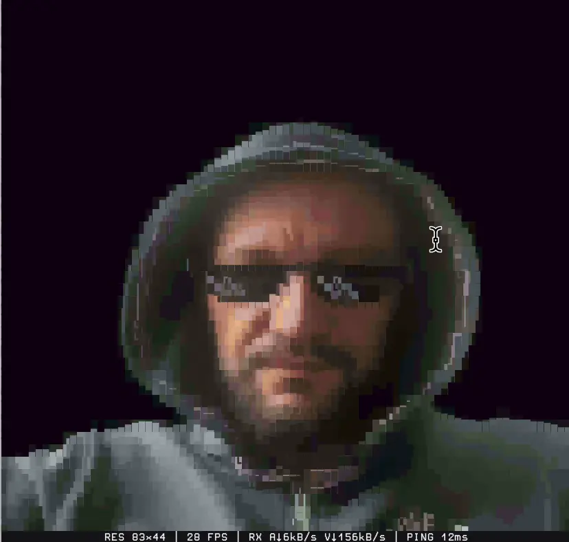
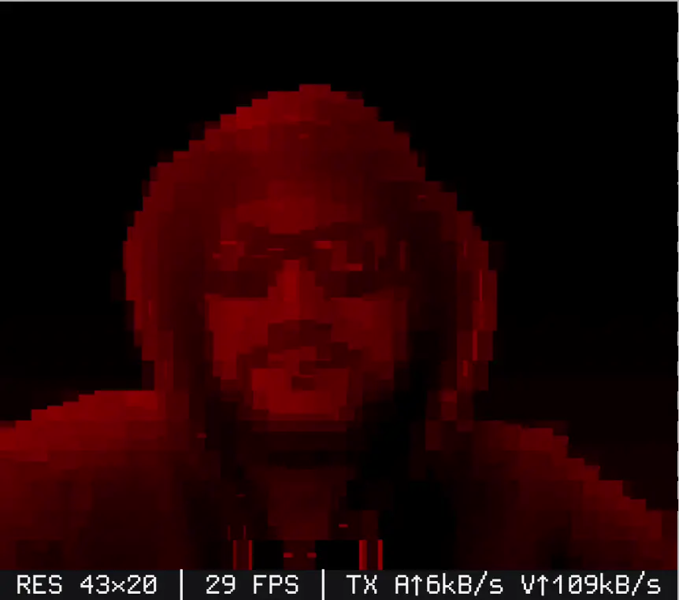
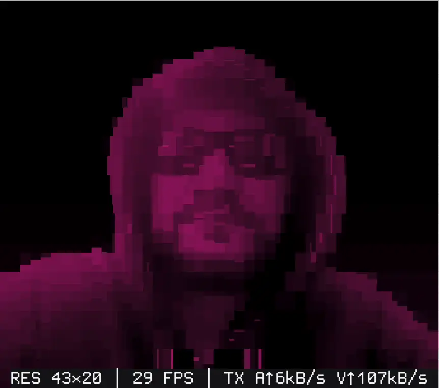
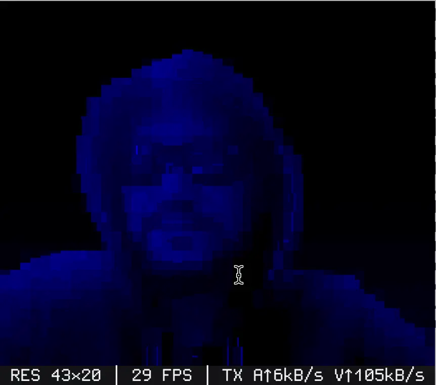

# Say

Say is a terminal‑first voice and video call utility that builds an embedded
Yggdrasil node via [ygg](https://github.com/svanichkin/ygg) and speaks directly
to other peers over the Ygg overlay network.
Audio is captured and played with [malgo](https://github.com/gen2brain/malgo)
(miniaudio), processed with acoustic echo cancellation, encoded as pure-Go AMR-NB,
Opus or G.722, and sent via UDP for low latency. Video frames are sourced through
[gocam](https://github.com/svanichkin/gocam), compressed, then rendered in the
current terminal session using Unicode glyphs.





The project is intended as a lightweight experiment: share your Yggdrasil
address, run `say` on both ends, and you have voice/video without deploying an
external Yggdrasil daemon or web stack.

## Filters







## Features

- Embedded Yggdrasil node – no separate daemon required. All call traffic is
  end-to-end encrypted by Yggdrasil, and peer addresses are derived from their
  public keys.
- **Lower voice traffic.** Pure-Go AMR-NB (default, 4.75 kbit/s) uses about
  **90 % less** bandwidth than the 48 kbit/s G.722 of v0.1.3; Opus (12 kbit/s)
  about **75 % less**. G.722 is still available with `-audio-codec g722`.
- Acoustic echo cancellation with a reference delay estimated from the requested
  speaker buffer. The filter resets on reference discontinuities; actual device
  latency (especially Bluetooth) can differ from this estimate.
- Video in a two-pane terminal layout (square panes), synchronised with the
  audio of the same peer.
- **Adaptive video frame rate and detail.** The receiver reports lost and
  undecodable frames; on loss the sender first raises the cell hold (coarser,
  lighter frames, up to 32 for small and 128 for large pictures) and lowers
  its frame rate only once the hold is at its maximum. On a clean path the
  frame rate comes back first, then the detail (5 fps floor, optional `-fps`
  cap).
- **Change-only video frames.** After a full frame, only the cells that
  changed are sent; together with `-video-hold` a still picture costs a few
  hundred bytes per frame instead of several kilobytes. A full frame follows
  about every half second, so a lost packet freezes the picture briefly
  instead of corrupting it. Both peers need this version.
- **Small fixed buffers.** Every call plays with a 10 ms x 2 speaker buffer
  (like the macOS system voice unit's ~10.7 ms IO buffer) and a 40 ms jitter
  buffer, in the LAN and over the internet alike. Steady clock drift between
  the two peers' sound cards is corrected by at most one sample per 20 ms
  frame.
- Capture sample indices survive dropped microphone blocks. A separate bounded
  send queue prevents a stalled transport from blocking capture/AEC; old encoded
  speech is discarded with its original timestamp preserved.
- **Local network calls.** Peers in the same LAN (or on the same machine) find
  each other by Yggdrasil multicast and connect directly instead of through
  internet peers. `-nolan` turns this off.
- **Chat and file transfer** during a call (see below).
- One call at a time: other callers get a "busy" answer; a peer that
  reconnects after a drop replaces its stale call.
- Friend list bootstrap via the same `config.json` that holds the Yggdrasil
  settings.

## Audio diagnostics

To compare raw microphone, echo reference and processed microphone, opt in to
local recording before launching Say:

```sh
SAY_AUDIO_TRACE=/tmp/say-audio ./bin/say
```

Each call writes a separate private three-channel WAV file (8 kHz, 16-bit PCM):
channel 1 is the microphone, channel 2 is the exact reference passed to the echo
filter, channel 3 is its output. Disk writes run separately from capture; the
log reports any diagnostic frames dropped if the disk cannot keep up. Recording
is off unless this environment variable is set. These files contain the call's
audio. Compare channels to locate whether distortion starts before or after
AEC; a real device recording is needed to verify its estimated delay.

## Chat and file transfer

The lower part of the call screen is a chat. Type a message and press Enter;
your messages appear on the left, the peer's on the right. Long messages wrap,
and wide characters (CJK, emoji) are measured correctly.

To send a file, type, paste or drag its path (or drop the file into the terminal,
which pastes a `file://` URI) and press Enter. Transfer progress replaces the
input line. The receiver saves the file to `~/Downloads` and confirms it; the
sender's chat shows **Sent** only after that confirmation, or the receiver's
error (for example, a full disk). File transfer adapts its rate to the call so
that voice and video stay smooth.

## Requirements

- Go **1.27.3** (minimum) with cgo enabled for native audio I/O. Both audio codecs are pure Go.
- A working microphone for voice calls and, if you enable video, a webcam that
  is supported by your OS (V4L2 on Linux, AVFoundation on macOS, Media
  Foundation on Windows).
- System libraries required by miniaudio / Gocam (on Linux ensure ALSA/ Pulse
  dev packages are available; on macOS you just need Xcode command line tools).
- Permission to access camera and microphone for the terminal session.

## Install manual

Go to [Releases](https://github.com/svanichkin/say/releases) download adn start it

## Install with install script from a GitHub release

```sh
curl -fsSL https://raw.githubusercontent.com/svanichkin/say/main/scripts/install-release.sh | bash
```

OR

```sh
wget -qO- https://raw.githubusercontent.com/svanichkin/say/main/scripts/install-release.sh | bash
```

The script detects your platform, downloads the latest release artifact from
GitHub, and installs `say` into a sensible default directory:

- macOS/Linux/BSD: `$HOME/.local/bin` for non‑root users, `/usr/local/bin` otherwise.
- Windows (MSYS/mingw/git-bash environments): `%USERPROFILE%\AppData\Local\Programs\say`.

Override the target via `INSTALL_DIR=/custom/path ./scripts/install-release.sh`.
Supply a specific tag with `VERSION=v0.4.0 ./scripts/install-release.sh`, or
point to a fork using `REPO=myuser/say ./scripts/install-release.sh`. Ensure
`curl`, `tar`, and (for Windows archives) `unzip` are available, and add the
chosen install directory to your `PATH` if needed.

## Installation with Go install

Very simple for linux/macos

```sh
CGO_ENABLED=1 go install github.com/svanichkin/say@latest
```

Then use

```sh
~/go/bin/say
```

Windows with CMD

```sh
set CGO_ENABLED=1
go install github.com/svanichkin/say@latest
```

Windows with Powershell

```sh
$env:CGO_ENABLED = "1"
go install github.com/svanichkin/say@latest
```

Then use 

```sh
C:\Users\USERNAME\go\bin\say.exe
```

## Installation with AUR

The package is also available on the AUR, if you use an AUR helper, you can install it for example with:

```sh
yay -S say
```

## Installation with Git

```sh
git clone https://github.com/svanichkin/say.git
cd say
make
```

You can also run the tool without building a binary linux/macos:

```sh
env CGO_ENABLED=1 
go run .
```

Windows with CMD

```sh
set CGO_ENABLED=1
go run .
```

Windows with Powershell

```sh
$env:CGO_ENABLED = "1"
go run .
```

## Configuration

Say stores its configuration under your OS config directory: on Linux this is
typically `$XDG_CONFIG_HOME/say/config.json` (or `~/.config/say/config.json` if
`XDG_CONFIG_HOME` is unset), while on macOS it resolves to
`~/Library/Application Support/say/config.json`. You can point to a different
path with `-config /path/to/config.json`.

The configuration file is a regular Yggdrasil node config plus an optional
`contacts_dir` key understood by Say:

```json
{
  "peers": [
    "tls://example.yggnode.net:443",
    "quic://203.0.113.10:8443"
  ],
  "contacts_dir": "/Users/me/Contacts"
}
```

Pass the same config file to Say – the embedded node uses it to bootstrap. When
`contacts_dir` is supplied (or overridden via `-contacts`), Say recursively
scans that directory. Each friend is represented as a folder that contains a
`say` subdirectory with text files holding IPv6 addresses:

```
~/Contacts/
  Alice G/
      say
  Bob D/
    say/
      phone
      console
```

- If the `say` directory holds a single file, its address is added as `Alice G`.
- If there are multiple files, each becomes a separate contact such as
  `Bob D/phone` or `Bob D/console`, where the suffix comes from the filename.

When selecting a friend inside the CLI, use those exact labels (`"Bob D/phone"`).
If you start `say` with `-contacts /path/to/contacts`, that path is persisted
into the active config so future runs can omit the flag.

The utility automatically updates the list of peers each time it starts.

## Usage

Run Say on one machine in listen mode:

```sh
./say
```

The program prints your Yggdrasil address. Share it with a friend and have them
dial you:

```sh
./say "200:abcd:1234:..."
```

Optionally pass the port as a separate argument, in any order:

```sh
./say "[200:abcd:1234:...]:7777"
./say 7777 "200:abcd:1234:..."
./say "200:abcd:1234:..." 7777
```

To bypass Yggdrasil and use ordinary TCP/UDP over a regular IP address, select
the plain transport explicitly:

```sh
./say -transport plain -port 7000
./say -transport plain -port 7001 "127.0.0.1:7000"
```

Select alternative configs explicitly via `-config work` (which maps to
`$XDG_CONFIG_HOME/say/work.json`). Positional arguments are interpreted as
either a dial target (`"200:abcd:..."`) or a friend name from contacts
(`"Alice G"`, `"Bob D/phone"`). To run the server with another profile, always
pass `-config`; bare tokens are no longer treated as profile names.

Audio and video are always enabled when hardware is present; no extra flags are
required. Use the same audio codec on both peers; codec negotiation is not part
of the current media protocol. Relevant CLI switches:

- Without `-log`, Say writes logs only to stderr. With `-log`, it also writes a log file next to the running executable using the config name, for example `-config client` -> `client.log`. The resolved path is printed on startup. Use `-log debug` for the most detailed file logging.
- `-port` – listening TCP/UDP port (defaults to `7777`).
- `-transport` – network backend: `ygg` (default, embedded Yggdrasil) or `plain` (ordinary TCP/UDP over regular IP). With `ygg`, nodes in the same local network discover each other by multicast and connect directly, bypassing internet peers.
- `-fps` – optional cap on the video frame rate. Without it every camera frame is sent and the rate adapts to the peer's frame loss (down to 5 fps).
- `-video-hold=N` – stops a still picture from shimmering: a cell keeps its previous glyph and colours while its new look differs by at most N (mean colour difference per pixel, default `10`, `0` disables; higher is calmer, but low-contrast details start to lag).
- `-video-hold-debug` – tint the cells kept by `-video-hold` lilac, to see how many there are.
- `-nomic` – listen only: the microphone is not opened and no audio is sent (handy for testing two instances on one machine without an echo loop).
- `-nolan` – turn off Yggdrasil LAN discovery (multicast peering in the local network).
- `-sysaudio` – use the system's voice processing instead of Say's own echo canceller: the system cancels echo, suppresses noise and controls gain. macOS: VoiceProcessingIO (as used by FaceTime) plays and records. Windows: the Voice Capture DSP records the default microphone and takes the default speaker's output as the echo reference; Say plays through the default speaker. On by default on macOS and Windows; `-sysaudio=false` uses Say's own audio (miniaudio and its echo canceller) instead. The speaker buffer is then chosen by the system; the output latency it reports is used to sync video (and logged). Falls back to Say's own audio where unavailable (other platforms for now).
- `-audio-codec` – choose `amrnb` (default), `opus` or `g722`. AMR-NB uses 4.75 kbit/s, G.722 (as in v0.1.3) about 48 kbit/s; select the same codec on both peers.
- `-config` – config profile or path; `-config work` maps to `$XDG_CONFIG_HOME/say/work.json`.
- `-log` – write `<config-name>.log` next to the running executable. `-log debug` also enables verbose debug logging.
- `-contacts` – override the contacts directory defined in the config.
- `-v` – verbose logging.
- `-version` – print version and exit.
- `-donate` – print donation information and exit.
- `-support` – print support link and exit.
- Color filters: `-red`, `-orange`, `-yellow`, `-green`, `-teal`, `-blue`, `-purple`, `-pink`, `-gray`, `-bw` – apply a tinted (or neutral) monochrome filter to the local/remote viewports (purely visual, codec stream stays untouched). Use at most one flag; if several are present the last one wins.

When media is disabled on both ends, Say falls back to a simple line‑based text
bridge over the established TCP session.

### Example call flow

1. Both peers ensure their configs contain working Yggdrasil peers.
2. Alice runs `./say`.
3. Bob runs `./say "alice-ygg-addr"`.
4. Speak! Use `Ctrl+C` to terminate; the app restores the terminal state.

## License

This project is distributed under the terms of the [MIT License](LICENSE).

### Donate

Monero 41uoDd1PNKm7j4LaBHHZ77ZPbEwEJzaRHhjEqFtKLZeWjd4sNfs3mtpbw1mcQrnNLBKWSJgui9ELEUz217Ui6kF13SmF4t5
