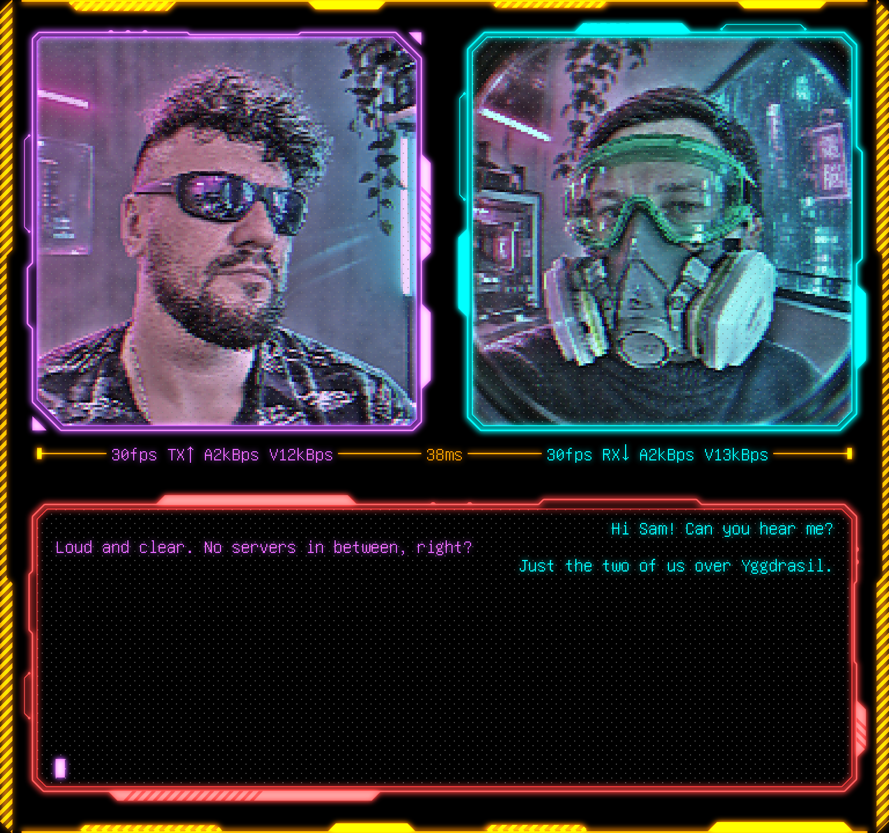
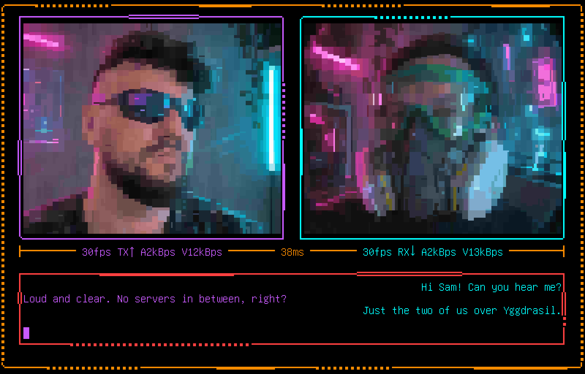

# Say

Say is a peer-to-peer voice and video call app that needs no server. It carries
its own [Yggdrasil](https://yggdrasil-network.github.io/) node (via
[ygg](https://github.com/svanichkin/ygg)): your address comes from your key,
calls are end-to-end encrypted, and they go straight between the two machines
whenever the network lets them. Say runs in a window on macOS, Windows and
Plan 9, and in any terminal.



The same call in a terminal, the video drawn in text cells:



## Highlights

- **No server, no account.** Share your address, and anyone with Say can call
  you. Your contacts are vCard files or your system's address book.
- **Light traffic.** Voice in AMR-NB at 4.75 kbit/s by default (Opus or G.722 if
  you like). The video is sent only where the picture changed.
- **Built for bad networks.** The send rate follows the path as WebRTC's does,
  a lost packet costs only itself, and NAT hole punching gives a direct link.
- **The system's voice processing** on macOS and Windows: echo cancellation,
  noise suppression, other sounds lowered during a call.
- **Chat and files** during a call, as fast as the path allows.
- **Who is online**: a green or red dot by each contact. Calls ring before
  they are answered.
- **One interface everywhere**: the same menus, keys and colours in the window
  and in a terminal, in 40 languages.

## Install

On macOS with Homebrew, `Say.app` and the `say` command in one go:

```sh
brew tap svanichkin/tap
brew trust svanichkin/tap   # newer Homebrew loads casks only from trusted taps
brew install --cask svanichkin/tap/say
```

`Say.app` goes into `/Applications`; `say` in Homebrew's bin
(`/opt/homebrew/bin` or `/usr/local/bin`) is a link to the program inside it,
so the window and the terminal are the same Say, and it comes before the
system's text-to-speech `/usr/bin/say`. `brew upgrade` brings new releases;
`brew uninstall --cask say` removes both.

Download your system's build from
[Releases](https://github.com/svanichkin/say/releases):

- **macOS**: `say-macos-arm64.zip` (Apple silicon) or `say-macos-amd64.zip`
  (Intel) holds `Say.app`, signed and notarized. Move it to Applications.
  `say-darwin-arm64.tar.gz` and `say-darwin-amd64.tar.gz` hold the terminal
  utility alone.
- **Windows**: `say-windows-amd64.tar.gz`. A double click opens the window,
  and `say` typed in a console works in it.
- **Linux** (amd64, arm64, armv7), **FreeBSD**, **OpenBSD**, **NetBSD** (amd64) and
  **Plan 9** (amd64, 386, arm): a `say` binary. On Linux, `amd64` runs on any
  x86-64 CPU and `amd64-v3` is faster on one with AVX2 (the install script
  picks).

You can also use the install script, which puts `say` on your `PATH`:

```sh
curl -fsSL https://raw.githubusercontent.com/svanichkin/say/main/scripts/install-release.sh | bash
```

It installs to `/usr/local/bin` on macOS (ahead of the system's text-to-speech
`/usr/bin/say`), to `~/.local/bin` on Linux and BSD, and to
`%USERPROFILE%\AppData\Local\Programs\say` on Windows (MSYS, Git Bash).
`INSTALL_DIR`, `VERSION` and `REPO` override the place, the tag and the
repository.

On Arch Linux, Say is in the AUR: `yay -S say`. To build it yourself, see
[Building](docs/building.md).

## First call

1. Start Say. The home screen opens with the menu **Contacts**, **Call an
   address**, **My address** and **Settings**.
2. **My address** shows your address. Enter copies it; send it to a friend.
3. Your friend types it into **Call an address** and presses Enter. You see
   **INCOMING CALL**; choose ✓ to answer.


From a terminal you can call straight away: `say 200:abcd:…`, or
`say "Jordan Lee"` for a contact.

## Documentation

- [Menus and keys](docs/menus.md): the home screen and how every menu works
- [Calls](docs/calls.md): dialling, answering, the call view, chat and files
- [Contacts](docs/contacts.md): the address book or a vCard folder, your card,
  cards sent in a call
- [Window, tray and terminal](docs/window.md): which one opens, hiding and
  quitting, the tray, video effects
- [Command line](docs/options.md): every option, the configuration files
- [How it works](docs/network.md): Yggdrasil, direct calls, rate control,
  codecs, protocol versions
- [Building](docs/building.md): from source, debug builds, the macOS app,
  releases, these screenshots

## License

[MIT](LICENSE).

### Donate

Monero 41uoDd1PNKm7j4LaBHHZ77ZPbEwEJzaRHhjEqFtKLZeWjd4sNfs3mtpbw1mcQrnNLBKWSJgui9ELEUz217Ui6kF13SmF4t5
