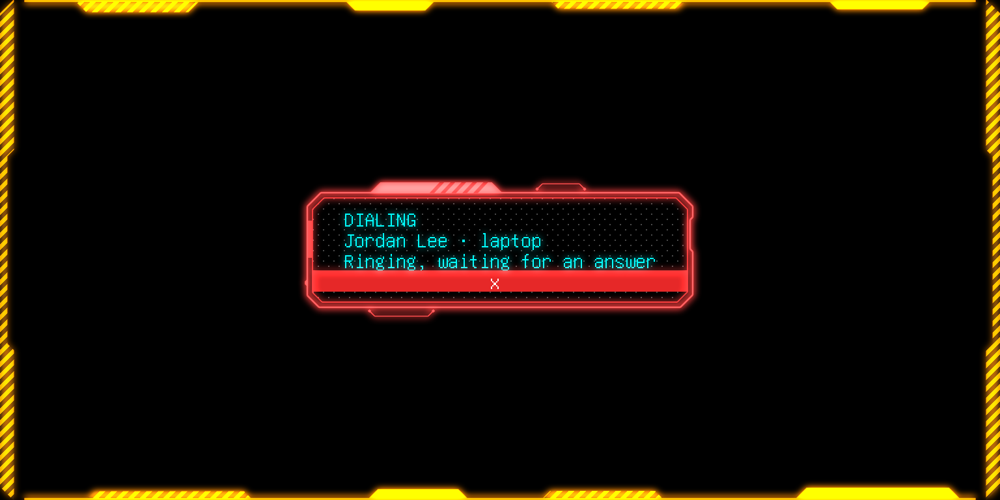
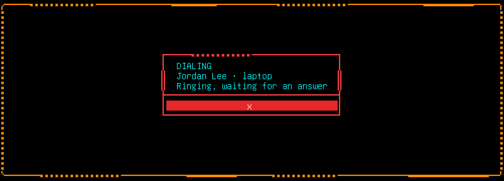
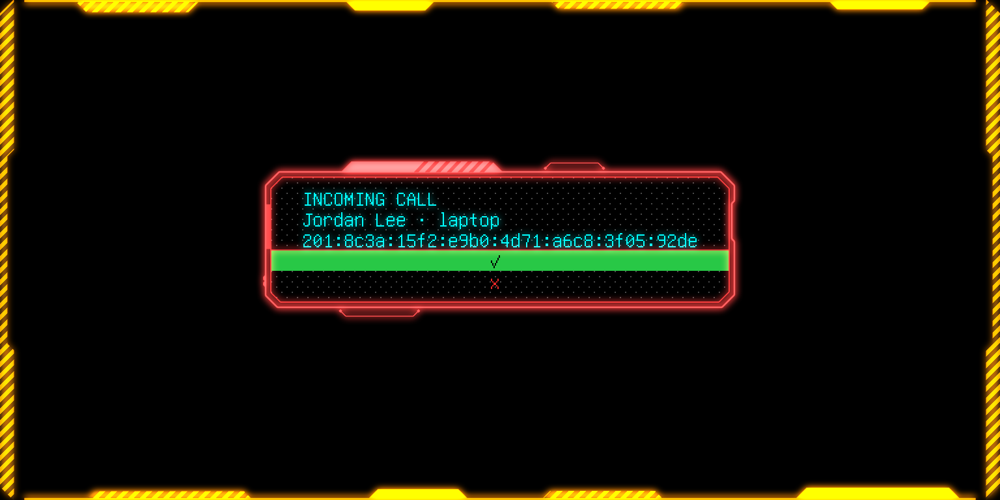
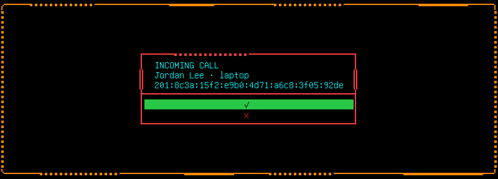
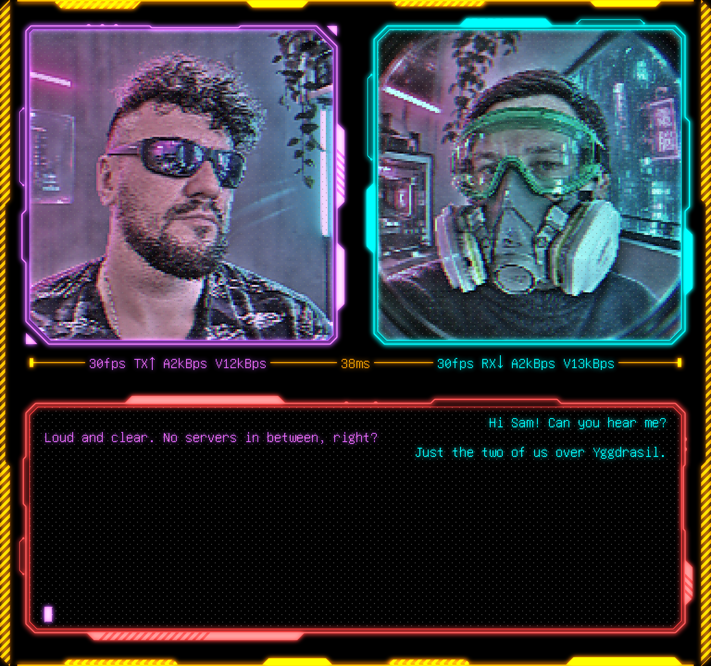
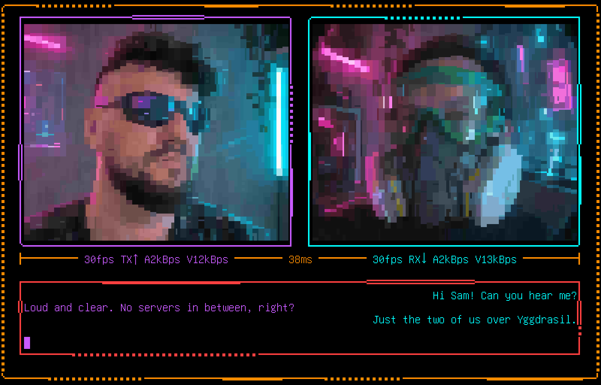
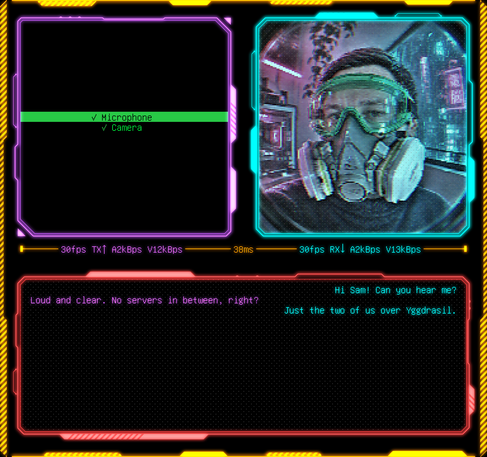
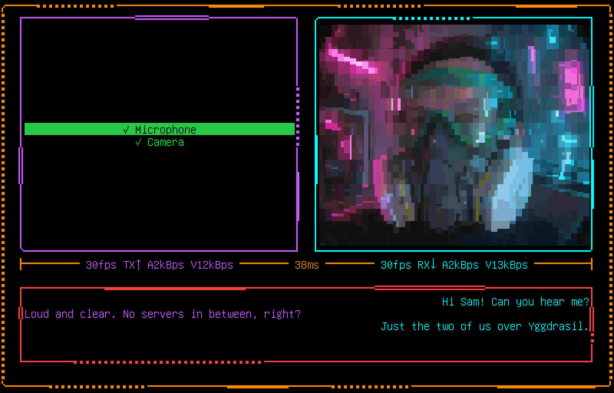

# Calls

[Documentation](README.md) › Calls

## Calling

Call a contact's device from **Contacts**, type an address into **Call an
address**, or start Say with the address or a contact's name:

```sh
say 200:abcd:1234:…                 # an address
say "[200:abcd:1234:…]:7001"        # with a port other than 7777
say "Jordan Lee"                    # a contact: the device called last, else the first
```

While the call is dialled, Say shows **DIALING**, who is called and how far it
got. `x` under the line (Enter, a click, or Esc) cancels it.

| Window | Terminal |
| --- | --- |
|  |  |

The call rings on the other side and is answered there. If it is declined,
not answered within 30 seconds, or the other side is busy, Say plays a short
sound and goes back to the home screen. A call made from the home screen is
tried three times before Say gives up.

Say only calls devices that answered the last time it asked whether Say runs
there (the green dot). It asks every 30 seconds while no call is on, and at
once when it starts or the contacts change.

## Answering

A call coming in shows **INCOMING CALL**, who is calling and their address,
with ✓ (answer) and `x` (decline) under a line. Use ↑ ↓ and Enter, or click;
Esc declines. If the window was hidden, it comes back.

| Window | Terminal |
| --- | --- |
|  |  |

While a call rings, or while one is on, any other caller gets a busy answer.
Say of protocol 14–16 does not ring: its calls are answered at once, as
before.

## The call view

Our camera is on the left, the peer's on the right. Under each pane is a
caption: frames per second, our sending rate (TX) or the peer's (RX) for
audio (A) and video (V), and between them the round trip to the peer. Below
the panes is the chat.

| Window | Terminal |
| --- | --- |
|  |  |

In the window the video is the picture itself, with an effect over it
(`-video-fx`, see [Window, tray and terminal](window.md)). In a terminal it is
drawn in text cells: each cell is one of Say's glyphs in two colours. Cmd+ and
Cmd− in the window (Ctrl on Windows) ask the peer for more or less detail.

## The video menus

← opens our pane's menu in its place, → the peer's. ↑ ↓ choose, Enter does it,
Esc closes the menu. In the window, the menu also shows while the pointer is
over its pane.

| Window | Terminal |
| --- | --- |
|  |  |

- Our pane: **Microphone** and **Camera** (✓ on, `x` off), and `x` to hang
  up.
- The peer's pane: **Their sound** and **Their video**, to stop playing or
  showing them on our side.

A click on a caption's A or V turns that sound or video off or on, as the
menus do. What is off shows as AMUTE or VMUTE in its caption.

Hanging up, on either side, takes both back to the home screen.

## Chat and files

Type a message and press Enter: yours appear on the left, the peer's on the
right. Typing goes to the chat even while a menu is open, and closes it.

To send a file, type, paste or drag its path (dropping a file into a terminal
pastes a `file://` address) and press Enter. Both sides see its progress in
the chat (how much of how much, the percentage, the speed), then the result
with the size, the average speed and the time. You can keep chatting; a
second file waits for the first. The receiver saves it to `~/Downloads` and
confirms; the sender sees **Sent** only after that, or the receiver's error.
Files go as fast as the path allows while keeping voice and video smooth.

## Cards

Right after a call connects, each side sends its own card: the names, the
nickname, and the devices with their labels and addresses. A card from an
address already in your contacts adds what it brings (a second device, a
nickname) to that card, and never overwrites. A card from an unknown address
waits under **Unconfirmed** in the contacts until you confirm it, add it to
a contact, or delete it. See [Contacts](contacts.md).
