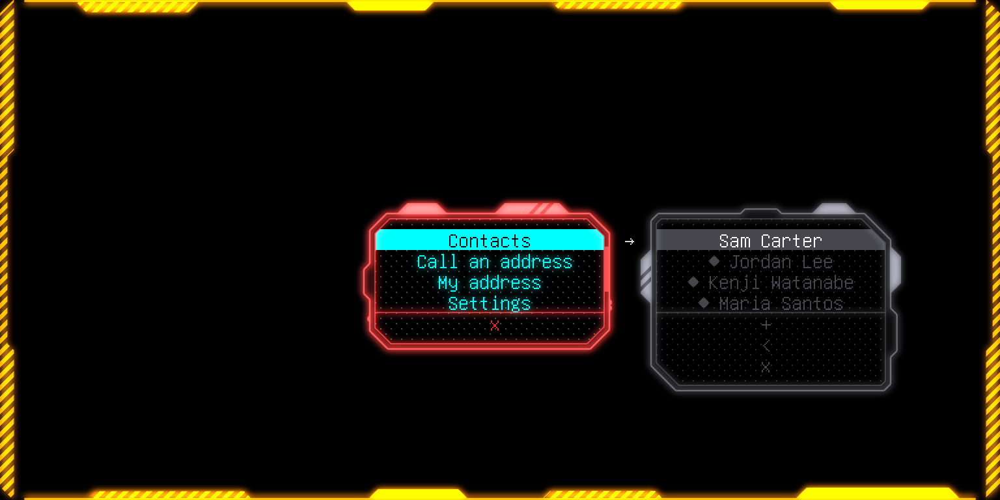
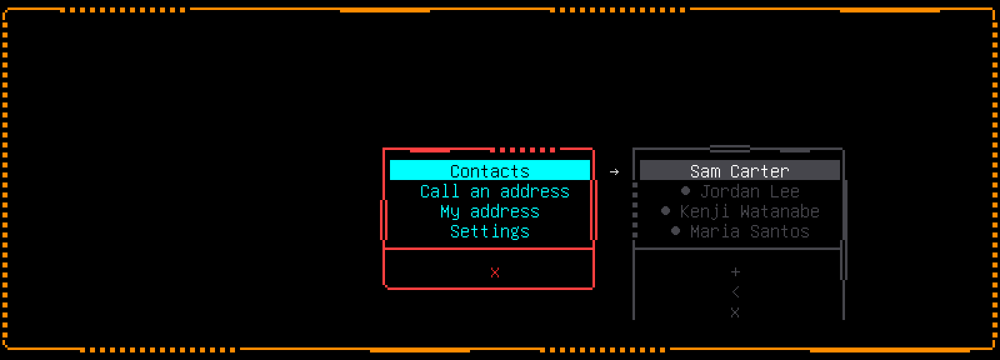
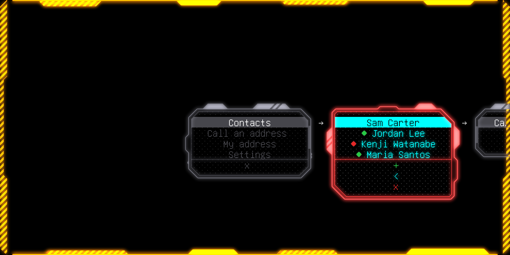
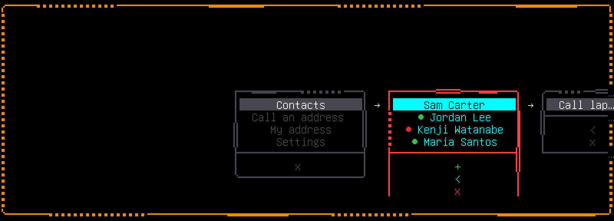
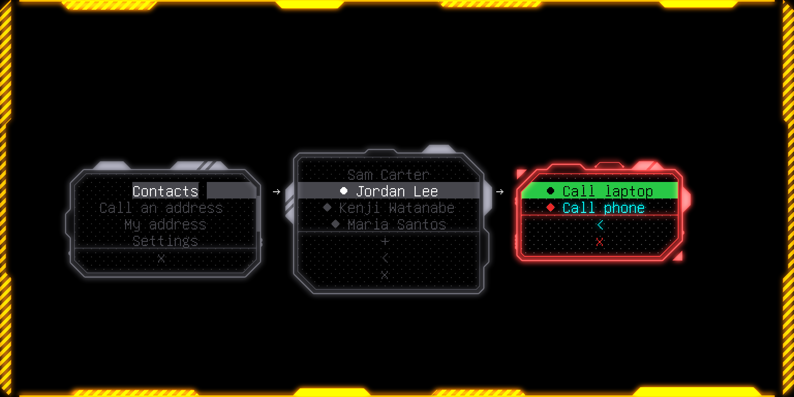
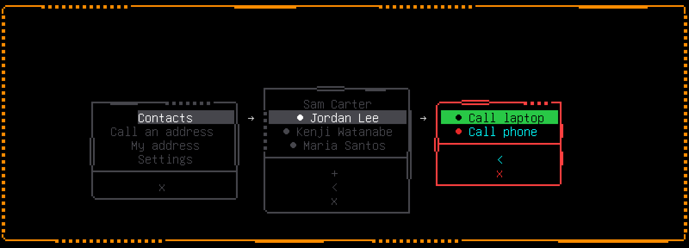
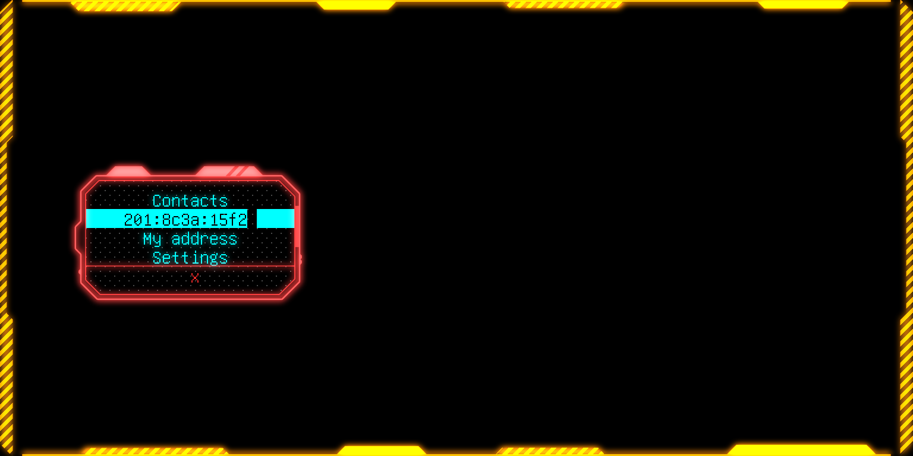
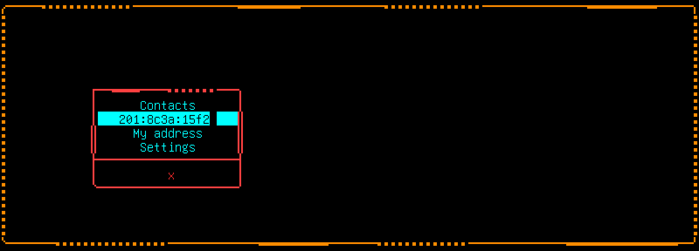
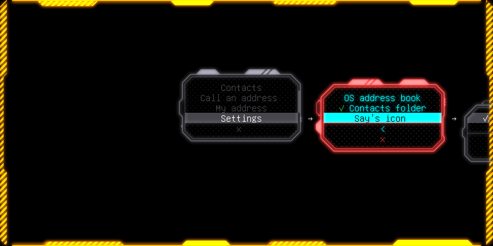
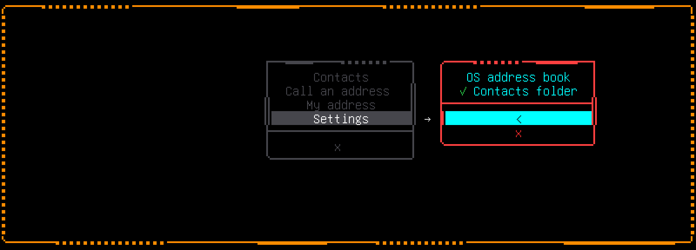

# Menus and keys

[Documentation](README.md) › Menus and keys

Say has one kind of menu, everywhere: on the home screen, on the call screen,
in the window and in a terminal. The same keys, marks and colours work in
all of them.

## The home screen

While no call is on, Say shows its home screen: a menu in columns. The column
you are in stands in the middle, with its chosen line on the middle row. The
arrows move the list under it. To its left is the column you came from, with
the line you took. To its right is a preview of what the chosen line opens.

| Window | Terminal |
| --- | --- |
|  |  |

The first column has four lines:

- **Contacts**: your card, then the people, then `+` to add one. See
  [Contacts](contacts.md).
- **Call an address**: a field. Type or paste an address and press Enter to
  call it. If it is not an address, the line blinks.
- **My address**: this Say's address, `[address]:port`, with the port only
  when it is not 7777. Enter or a click copies it.
- **Settings**: where the contacts come from and how names are shown, editing
  the contacts, and Say's icon (in the Dock or in the tray).

Under a line at the bottom is `x`. In the window it hides the window; Say
keeps waiting for calls (see [Window, tray and terminal](window.md)). In a
terminal it quits.

## Keys and the mouse

| Key | What it does |
| --- | --- |
| ↑ ↓ | Choose a line |
| → or Enter | Open the chosen line, or do it |
| ← or Esc | Go back a column |
| Letters | Jump to a name that starts with them (in a list of names) |
| Typing on a field | Edit it at once: no Enter needed to start |
| Pasting an address | Call it at once |

A click on a line does what Enter does. In the window, hovering over a video
pane during a call shows that pane's menu.

## Lines and marks

A person opens to their devices. A green dot means the device answered the
last time Say asked; a red dot means it did not, and Enter on it only makes
it blink. Your own device is shown on your card, but it cannot be called.

| Window | Terminal |
| --- | --- |
|  |  |
|  |  |

Each mark sits to the left of its text:

| Mark | Meaning |
| --- | --- |
| ✓ (green) | On, or chosen |
| `x` (red) | Off |
| → | Opens another menu |
| ● green / red | Online / not online |

Under the line at the bottom of a menu:

| Item | What it does |
| --- | --- |
| `+` (green) | Add (a contact, a device) |
| `−` (red) | Delete. The first press turns it into **Delete forever**; the second deletes. Moving off it, or leaving the menu, turns it back into `−` |
| `<` | Back one column |
| `x` (red) | Close: back to the first column; there, hide the window or quit. In a call's menu it hangs up; on the dialling screen it cancels the call |

## Fields

A field shows what it holds. When it is chosen, a blinking cursor appears,
as in the chat. Type to change it; it is saved as you leave it. Below, an
address being typed into **Call an address**:

| Window | Terminal |
| --- | --- |
|  |  |

## Settings

| Window | Terminal |
| --- | --- |
|  |  |

- **OS address book** (macOS) or **Contacts folder**: where the contacts come
  from; the one in use is ticked. Entering one chooses it and opens its
  settings (see [Contacts](contacts.md)):
  - the folder's path (to choose another folder);
  - **My card**: which card is yours, and `+` to make one;
  - **This device's label**: what this device is called on your card;
  - **Show contacts as**: nickname, first and last name, last and first
    name, or initials and last name;
  - **Edit contacts**: your card and the people, each opening to its form
    (names, devices, `+` for a device, `−` to delete the person), and `+`
    for a new person.
- **Say's icon**: **In the Dock**, or **In the tray** (macOS). See
  [Window, tray and terminal](window.md).

## Colours

- Each frame is drawn by the same generator in the window and in the terminal
  (lines and corners in the terminal). Windows without video (the home menu,
  the dialling screen, an incoming call, the chat) take the chat's colour. A
  call's video menu takes its video's colour.
- The menu you are in shows its text in its frame's colour, inverted. The
  columns beside it are grey, marks included.
- The chosen line's block takes its mark's colour: red for `x`, `−` and a red
  dot, green for `+`, ✓ and a green dot. A line without a mark takes its
  text's colour. On the block, the text and the mark are white or black,
  whichever reads better.
